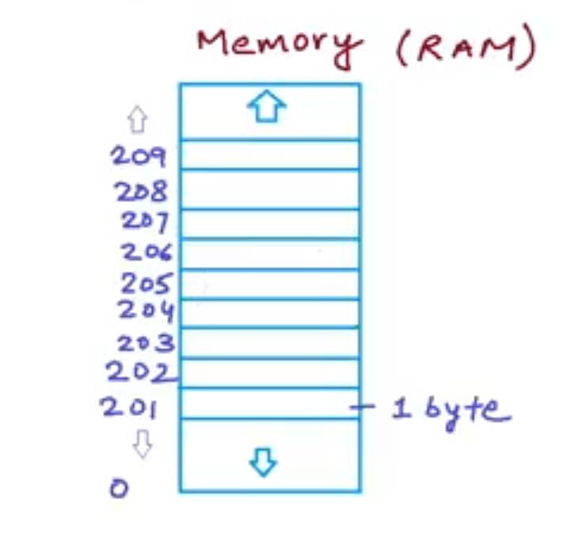
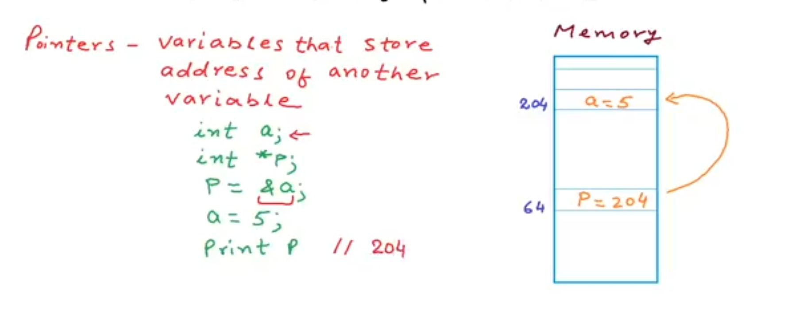

# C Programming Notes: Pointers 🧭

## Introduction

Pointers are one of the most powerful features in the C programming language. They allow programs to work directly with memory addresses. At first, pointers feel like trying to read a treasure map written by a squirrel with a caffeine addiction ☕🐿️, but once understood, they unlock serious programming power.

Pointers are used in:

* Embedded systems
* Operating systems
* Device drivers
* Dynamic memory allocation
* Arrays and strings
* Linked lists and data structures
* High performance applications

---

# 1. What Is a Pointer?

A pointer is a variable that stores the memory address of another variable.

Example:

```c
int age = 20;
int *ptr = &age;
```

Explanation:

* `age` stores the value `20`
* `&age` means “address of age”
* `ptr` stores that address

---

# 2. Understanding Memory

Every variable created in a program is stored somewhere in memory.



Example:

```c
int x = 5;
```
Note this: `Address Space Layout Randomization` 
The computer may store `x` at:

```text
0x7ffd1ab23c
```

That hexadecimal number is the memory address.

Think of RAM like a giant apartment building:

* Variables are tenants
* Memory addresses are apartment numbers
* Pointers are little papers containing apartment numbers



---

# 3. Pointer Syntax

## Declaring a Pointer

```c
int *ptr;
```

This means:

* `ptr` is a pointer
* It can store the address of an integer

---

# 4. The Address Operator `&`

The `&` operator gives the memory address of a variable.

Example:

```c
int num = 10;
printf("%p", &num);
```

Output:

```text
0x61ff08
```

`%p` is the format specifier for addresses.

---

# 5. The Dereference Operator `*`

The `*` operator accesses the value stored at an address.

Example:

```c
int num = 10;
int *ptr = &num;

printf("%d", *ptr);
```

Output:

```text
10
```

Explanation:

* `ptr` stores the address
* `*ptr` accesses the value at that address

---

# 6. Full Example

```c
#include <stdio.h>

int main()
{
    int age = 25;
    int *ptr = &age;

    printf("Value of age: %d\n", age);
    printf("Address of age: %p\n", &age);
    printf("Pointer value: %p\n", ptr);
    printf("Value using pointer: %d\n", *ptr);

    return 0;
}
```

---

# 7. Important Pointer Concepts

## Pointer Variable

```c
int *ptr;
```

Stores an address.

---

## Address Of Operator

```c
&variable
```

Gets address.

---

## Dereference Operator

```c
*ptr
```

Gets actual value from address.

---

# 8. Changing Variable Values Using Pointers

Pointers can modify variables directly.

Example:

```c
#include <stdio.h>

int main()
{
    int number = 50;
    int *ptr = &number;

    *ptr = 100;

    printf("%d", number);

    return 0;
}
```

Output:

```text
100
```

The pointer reached into memory like a mechanic opening the engine bay 🔧.

---

# 9. Pointer Data Types

Pointers must match the datatype they point to.

## Integer Pointer

```c
int *ptr;
```

## Float Pointer

```c
float *ptr;
```

## Character Pointer

```c
char *ptr;
```

---

# 10. NULL Pointer

A NULL pointer points to nothing.

Example:

```c
int *ptr = NULL;
```

Useful for:

* Safety
* Initialization
* Avoiding garbage addresses

---

# 11. Wild Pointers ⚠️

A wild pointer is an uninitialized pointer.

Bad example:

```c
int *ptr;
*ptr = 5;
```

This may crash the program.

Always initialize pointers.

Good example:

```c
int *ptr = NULL;
```

---

# 12. Pointer Arithmetic

Pointers can move through memory.

Example:

```c
int arr[3] = {10, 20, 30};
int *ptr = arr;

printf("%d\n", *ptr);
ptr++;
printf("%d\n", *ptr);
```

Output:

```text
10
20
```

Why?

Because the pointer moved to the next integer in memory.

---

# 13. Pointers and Arrays

Arrays and pointers are closely related.

Example:

```c
int numbers[3] = {1, 2, 3};

printf("%d\n", numbers[0]);
printf("%d\n", *(numbers + 0));
```

Both produce:

```text
1
```

---

# 14. Traversing Arrays with Pointers

```c
#include <stdio.h>

int main()
{
    int arr[5] = {1,2,3,4,5};
    int *ptr = arr;

    for(int i = 0; i < 5; i++)
    {
        printf("%d\n", *(ptr + i));
    }

    return 0;
}
```

---

# 15. Pointers and Functions

Pointers allow functions to modify original variables.

## Without Pointer

```c
void change(int x)
{
    x = 100;
}
```

Original variable does not change.

---

## With Pointer

```c
void change(int *x)
{
    *x = 100;
}
```

Now the original variable changes.

---

# 16. Pass By Reference

Example:

```c
#include <stdio.h>

void update(int *num)
{
    *num = 500;
}

int main()
{
    int x = 10;

    update(&x);

    printf("%d", x);

    return 0;
}
```

Output:

```text
500
```

---

# 17. Double Pointers

A pointer can point to another pointer.

Example:

```c
int x = 5;
int *ptr = &x;
int **dptr = &ptr;
```

Diagram:

```text
x       = 5
ptr     = address of x
*dptr   = ptr
**dptr  = x
```

---

# 18. Pointer to Character Strings

```c
char *name = "Michael";
```

Characters are stored in memory one after another.

---

# 19. Dynamic Memory Allocation

Pointers are heavily used with:

* `malloc()`
* `calloc()`
* `realloc()`
* `free()`

Example:

```c
#include <stdlib.h>

int *ptr;
ptr = (int*) malloc(sizeof(int));
```

This allocates memory during runtime.

---

# 20. Common Pointer Mistakes

## Forgetting Initialization

```c
int *ptr;
```

Dangerous.

---

## Dereferencing NULL

```c
int *ptr = NULL;
*ptr = 5;
```

Crash territory 💥.

---

## Memory Leaks

```c
ptr = malloc(sizeof(int));
```

If `free(ptr)` is forgotten, memory leaks occur.

---

# 21. Memory Leak Example

Bad:

```c
int *ptr = malloc(sizeof(int));
```

Good:

```c
free(ptr);
```

---

# 22. Practical Embedded Systems Use

Pointers are used everywhere in embedded systems.

Example:

```c
#define GPIOA_ODR (*(volatile unsigned int*)0x40020014)
```

This accesses a hardware register directly.

That tiny line is basically whispering directly into the silicon’s ear ⚡.

---

# 23. Pointer Practice Questions

## Beginner

1. What is a pointer?
2. What does `&` mean?
3. What does `*` mean?
4. What is dereferencing?
5. Why are pointers useful?

---

## Intermediate

1. Write a program to swap two numbers using pointers.
2. Traverse an array using pointers.
3. Create a function that modifies a variable using pointers.
4. Create a pointer to a pointer.

---

# 24. Pointer Mini Projects 🚀

## Project 1: Swap Two Numbers

```c
void swap(int *a, int *b)
{
    int temp = *a;
    *a = *b;
    *b = temp;
}
```

---

## Project 2: Array Sum Using Pointers

Calculate sum of array elements using pointers.

---

## Project 3: Simple Memory Allocator

Use `malloc()` and `free()`.

---

# 25. Visualizing Pointers

Example:

```c
int x = 10;
int *ptr = &x;
```

Memory view:

```text
Variable     Address       Value
x            0x100         10
ptr          0x200         0x100
```

---

# 26. Golden Rules of Pointers ✨

1. Always initialize pointers.
2. Match pointer datatype correctly.
3. Never dereference NULL.
4. Free dynamically allocated memory.
5. Understand memory before using advanced pointers.
6. Practice daily.

---

# 27. Super Important Mental Model

Remember this forever:

```text
variable     -> stores value
pointer      -> stores address
*pointer     -> accesses value at address
&variable    -> gets address of variable
```

This is the heartbeat of pointers.

---

# 28. Tiny Pointer Cheat Sheet 📌

## Create Variable

```c
int x = 5;
```

---

## Get Address

```c
&x
```

---

## Create Pointer

```c
int *ptr = &x;
```

---

## Access Value Through Pointer

```c
*ptr
```

---

## Change Value Through Pointer

```c
*ptr = 20;
```

---

# 29. Final Advice

Pointers are difficult at first because you are no longer just thinking about values.

You are thinking about:

* Memory
* Addresses
* Data flow
* Hardware behavior

Once the fog clears, many advanced programming concepts suddenly become easier:

* Data structures
* Embedded systems
* Operating systems
* Networking
* Game engines
* Compilers

Pointers are where C stops being a normal language and starts feeling like a backstage pass into the computer itself 🎛️.

---

# 30. Practice Every Day

The best way to master pointers:

* Write small programs
* Draw memory diagrams
* Trace addresses manually
* Debug code slowly
* Experiment constantly

Pointers are not learned by reading once.
They are learned by touching memory repeatedly until your brain starts seeing addresses naturally.

---

# Recommended Exercises

1. Reverse an array using pointers
2. Swap strings using pointers
3. Build a mini linked list
4. Create a dynamic integer array
5. Build a stack using pointers
6. Access microcontroller registers using pointers

---

# End of Notes 📘

Keep coding. Keep breaking things. Keep rebuilding them.

That is how programmers evolve from button-clickers into memory tamers 🧠⚡.
